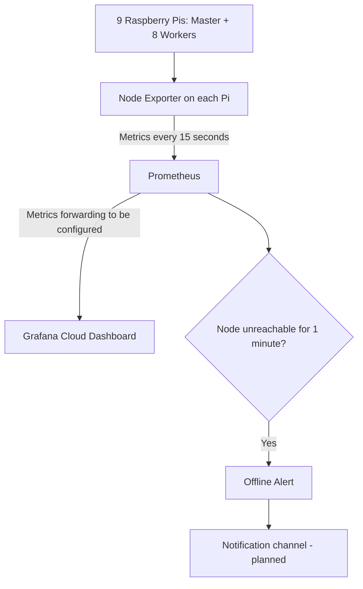

# Task 4 – Monitoring Setup

## 1. Objective
Monitor the Raspberry Pi cluster used for drone detection, visualize system health in Grafana, and detect node failures.

## 2. Cluster Architecture
- Master: Raspberry Pi 4 (`master.local`)
- Workers: Eight Raspberry Pi 3 (`worker1.local` to `worker8.local`)
- Total: 9 Raspberry Pis
- Monitoring stack: Node Exporter, Prometheus, Grafana Cloud
## Monitoring Architecture

## 3. Current Progress
- Created a Python monitoring prototype (`Drone_Monitoring.py`).
- Created a Grafana CPU usage dashboard with simulated data.
- Prepared `prometheus.yml` for nine Raspberry Pis.
- Prepared `alerts.yml` for unreachable nodes.
- Linked alert rules to the Prometheus configuration.

## 4. Planned Deployment
1. Obtain the Raspberry Pi cluster and SSH credentials from Task 5.
2. Confirm all hostnames and network connectivity.
3. Install and start Node Exporter on each Pi, using the correct architecture-specific binaries.
4. Verify that each Pi exposes metrics on port 9100.
5. Deploy Prometheus on a host that can reach all nine Pis and load `prometheus.yml` and `alerts.yml`.
6. Check all nine targets and alert rules in Prometheus.
7. Connect live metrics to Grafana Cloud using an appropriate secure data collection or forwarding method.
8. Replace simulated dashboard data with real metrics.

## 5. Fault Tolerance Test Plan
1. Confirm all nine nodes report as reachable.
2. With team approval, safely disconnect or shut down one worker.
3. Verify Prometheus reports `up = 0` for that target.
4. Verify that the offline alert fires after one minute.
5. Check the configured notification channel, if available.
6. Restore the worker and verify recovery.
7. Document screenshots, timestamps, and test results.

## 6. Remaining Work
- Confirm where Prometheus will run.
- Obtain access to the Raspberry Pi cluster.
- Deploy and validate Node Exporter and Prometheus.
- Configure live metrics and notifications.
- Test CPU, RAM, temperature, node status, and failure recovery.

## 7. Notes
The Grafana CPU values currently come from static simulated JSON data and do not represent live Raspberry Pi measurements. The GitHub configurations have not yet been deployed or validated on the real cluster. A failed scrape indicates an unreachable metrics endpoint, not necessarily a powered-off Raspberry Pi.

## 8. Node Exporter Deployment

### Target devices
- Master: Raspberry Pi 4 (`master.local`)
- Workers: Eight Raspberry Pi 3 (`worker1.local` to `worker8.local`)
- Total: 9 nodes
- Metrics endpoint: Port `9100`

### Deployment plan
1. Connect all Raspberry Pis to the same network as Prometheus.
2. Verify SSH access and the operating system architecture of each Pi.
3. Install the compatible Prometheus Node Exporter version on each Pi.
4. Configure Node Exporter to run as a system service.
5. Verify that each device exposes metrics at `http://<pi-address>:9100/metrics`.
6. Start Prometheus using `prometheus.yml`.
7. Verify all nine targets in Prometheus under `/targets`.
8. Confirm metrics arrive in Grafana Cloud.

### Verification
- CPU usage: `node_cpu_seconds_total`
- RAM usage: `node_memory_MemAvailable_bytes` and `node_memory_MemTotal_bytes`
- Node reachability: `up{job="raspberry-pi-cluster"}`
- Temperature: Verify a supported CPU temperature metric on the actual Raspberry Pi hardware.

### Status
Deployment and live validation are pending hardware access.
  
